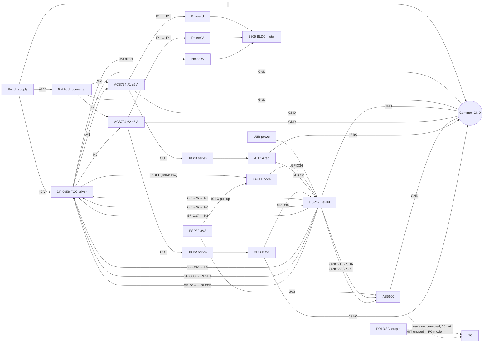

# DFRobot SimpleFOCmini (DRI0058) + ESP32-WROOM

This folder contains a bounded motor bring-up application for the DRI0058
three-PWM driver. Open-loop operation does not require the optional AS5600.
This firmware is separate from the simulator and does not run an RL policy.

## Wiring

Power: bench supply +9 V -> DRI0058 VCC; supply − -> DRI0058 power GND.
Power the ESP32 by USB. ACS724 sensors require regulated 5 V, not 9 V; use a
5 V buck from the supply if needed. Leave DRI0058 VDD/3.3 V unconnected.

**Common GND:** bench supply −, DRI0058 GND, ESP32 GND, ACS724 #1/#2 GND,
AS5600 GND, and 5 V buck GND.

| ESP32 pin | Connect to |
| --- | --- |
| GPIO25 / 26 / 27 | DRI0058 N1 / N2 / N3 |
| GPIO32 | DRI0058 EN |
| GPIO33 | DRI0058 RESET |
| GPIO14 | DRI0058 SLEEP |
| GPIO34 | DRI0058 FAULT; add 10 kΩ pull-up from this joined node to ESP32 3V3 |
| GPIO21 / 22 | AS5600 SDA / SCL |
| GPIO35 / 36 | ACS724 #1 / #2 OUT through separate dividers |

Motor and current sensors: DRI M1 -> ACS724 #1 IP+ -> IP− -> motor phase U;
DRI M2 -> ACS724 #2 IP+ -> IP− -> phase V; DRI M3 -> phase W. These are the
two Pololu ACS724 `05AB` ±5 A sensors. Connect each sensor VCC to regulated 5 V.
For each OUT, connect OUT -> 10 kΩ -> ADC pin, with 18 kΩ from that ADC pin to
common GND. Do not connect OUT directly to ESP32. DRI CS1/CS2/CS3 are unused.

AS5600: VCC -> ESP32 3V3; GND -> common GND; SDA -> GPIO21; SCL -> GPIO22; OUT
is unused in I²C mode. Check that the module's I²C pull-ups go to 3.3 V.

### Wiring diagram

This is a logical wiring diagram, not a physical perfboard layout. Keep the
motor-phase wiring insulated and do not route phase current through perfboard
copper. The ESP32 is USB-powered here, matching the wiring instructions above.



The firmware pin map targets the original ESP32-WROOM. Keep motor power off
while wiring; use secure connections for motor phases, and verify the DRI header
labels against your board revision. The DRI0058 VDD output is limited to 10 mA;
do not use it to power the sensors. FAULT is active low and GPIO34 has no
internal pull-up. This wiring/configuration has not yet been physically
validated with the ACS724 FOC setup.

## Firmware behavior

The Arduino profile has the user-confirmed 9 V supply and seven verified pole
pairs in source. These values were reported by the user; this workspace has not
independently measured the supply or motor. The native ESP-IDF Kconfig defaults
remain zero for bus voltage and pole pairs; its verified local build
configuration has 9000 mV, 7 pole pairs, 500 mV motor amplitude, and 5000
mrad/s. Pole pairs are verified motor data, not the number of poles.

Driver PWM range and motor phase amplitude are separate. The Arduino adapter
sets the driver range to the 9 V bus and the motor amplitude to 1.50 V; the
native ESP-IDF build retains its saved 0.50 V setting. AS5600 alignment uses
0.30 V. For centered sine modulation, the validation requires
`2 * amplitude <= driver range`; alignment amplitude must also be no greater
than the motor amplitude. This prevents clipping of the requested initial
waveform. In the AS5600 profile, phase-current feedback drives SimpleFOC's FOC
current torque controller, limited in software to 0.5 A. This is not a hardware
current cutoff; the open-loop profile remains voltage-driven and is not FOC.

Startup is disarmed. `ARM` only unlocks commands in open-loop mode; it leaves
EN low while SLEEP stays high. Send a complete `T<rad/s>` command to enable the stage and run
the motor. For the first unloaded spin, the sequence is:

```text
ARM
T1
STOP
```

`STOP` and `T0` both set the target to zero, disarm, and drive EN low while
leaving the driver awake so FAULT remains observable.
Commands accept a finite signed target within ±5 rad/s and require a complete
line ending (CR, LF, or CRLF). Incomplete, overlong, malformed, or out-of-range
lines leave the prior target unchanged. Input parsing is limited to 64 bytes per
iteration. Avoid flooding commands because serial logging can still delay
control updates.

With AS5600 mode selected, `ARM` energizes the stage for `initFOC()` rotor and
current-sense alignment. A failed alignment latches the shutdown until reboot;
successful alignment leaves the gate disabled while the armed controller waits
for a nonzero target. Open-loop mode skips rotor/current-sense phase alignment
and stays voltage-driven. It ignores AS5600 and ACS724; only the AS5600 FOC
profile initializes the ACS724 current-sense objects. Both controller modes use
the same guarded external EN/FAULT handling.

FAULT is active low. The DRI0058 schematic pulls FAULT to the driver's V3P3
rail. Firmware does not interpret the pin during sleep or the wake transition;
it checks the line after the wake/reset delays, then checks again with the ISR
installed. A low level after that settling sequence is treated as a real fault
and latches shutdown. On the original ESP32-WROOM, a falling-edge ISR uses
IRAM-resident direct GPIO register writes to clear both external EN and SLEEP,
including while alignment blocks the application loop. The fault latch cannot
be cleared by serial commands. Hardware FAULT, driver initialization failure,
motor initialization failure, or calibration failure requires inspection and
a reboot. The IDF adapter installs its own IRAM ISR service; Arduino does the
same instead of relying on the core's optional flash-resident dispatcher. The
direct GPIO bank mapping is guarded to the original ESP32 target.

These interlocks are software bring-up controls, not a safety system. Use a
current-limited supply, an unloaded motor, and a physical disconnect. The
firmware cannot enforce the DRI0058 current rating, detect all wiring faults, or
regulate speed under load in open-loop mode.

## Build

Build only; these commands do not upload or operate hardware. Run from the
repository root. PlatformIO Core 6.1.19 is pinned because pioarduino 55.03.37
expects SCons 4.8.1; Core 6.2.0 conflicts with this platform's SCons requirement.
This machine already has `.venv` configured. For a fresh checkout, create it
once; use the install command to update an existing environment:

```bash
uv venv --python 3.12 .venv  # Fresh checkout only; skip if .venv exists.
uv pip install --python .venv/bin/python -r hw/focmini/requirements-build.txt
```

Then use `.venv/bin/pio` for these builds. The `esp32dev_as5600` environment is
the FOC application; `FOCMINI_PROGRAM` selects the source file and defaults to
`main.cpp`. The sensorless diagnostic uses this same environment—no additional
PlatformIO environment is needed:

```bash
# Build the FOC application from main.cpp.
FOCMINI_PROGRAM=main ./.venv/bin/pio run -d hw/focmini -e esp32dev_as5600

# Build the sensorless diagnostic from motor_test.cpp using the same env.
FOCMINI_PROGRAM=motor_test ./.venv/bin/pio run -d hw/focmini -e esp32dev_as5600

# Existing non-FOC firmware build if needed (still from main.cpp).
FOCMINI_PROGRAM=main ./.venv/bin/pio run -d hw/focmini -e esp32dev_open_loop

# ACS724 readings only: no encoder, driver initialization, or motor output.
./.venv/bin/pio run -d hw/focmini -e esp32dev_acs724_monitor

# Native ESP-IDF profile. Kconfig defaults leave it disarmed.
./.venv/bin/pio run -d hw/focmini/idf -e esp32dev_idf -t menuconfig
./.venv/bin/pio run -d hw/focmini/idf -e esp32dev_idf
```

For native menu configuration, set the measured bus voltage and verified pole
pairs, retain a motor phase amplitude no greater than half the bus range, and
keep the command limit at or below 5000 mrad/s. The native project pins
`esp_simplefoc` 1.4.1; its dependency resolves Arduino-FOC 2.4.0. The Arduino
project uses pinned pioarduino 55.03.37 and Arduino-FOC 2.4.0. Build logs,
source hashes, and host regression evidence are recorded under ignored
`results/`. No upload or physical motor test is implied by a successful build.

After reviewing the wiring/configuration and building, the operator can upload
an Arduino program. Keep the motor supply disconnected during USB upload. The
detected CP2102N port for this board is
`/dev/cu.usbserial-3120` (the port can change):

```bash
FOCMINI_PROGRAM=main ./.venv/bin/pio run -d hw/focmini -e esp32dev_as5600 -t upload \
  --upload-port /dev/cu.usbserial-3120
./.venv/bin/pio device monitor -d hw/focmini -b 115200 \
  --port /dev/cu.usbserial-3120
```

After upload, connect the measured 9 V motor supply with the motor unloaded and
current limit set, then press the ESP32 EN/reset button to boot while the driver
is powered. Open the serial monitor and wait for `READY DISARMED OPEN LOOP`;
opening the monitor may itself reset the ESP32. If the firmware reports an
active FAULT, inspect and clear the cause, then press EN/reset to reboot. Serial
commands cannot clear a FAULT latch. Once READY appears, enter `ARM`, `T1`, then
`STOP` as complete lines. The port shown is the user-confirmed CP2102N adapter
connected to ESP32-D0WD-V3, 4 MB flash; it can change when the adapter is moved.

## Standalone sensorless motor diagnostic

`src/motor_test.cpp` is a separate, intentionally simple open-loop diagnostic;
it contains no AS5600 or ACS724 objects. It uses the same DRI0058 pin map and
FAULT interlock as the FOC firmware, starts disarmed, and refuses to run if
FAULT is active. The `run_motor.sh --program motor-test` path waits for
`READY DISARMED MOTOR TEST`, aborts on startup FAULT, asks for a separate `y`
confirmation, then sends `RUN10` and prints the serial output. The firmware
limits the run to 10 seconds and disables EN automatically; `Ctrl-C` in the
helper sends `STOP`. For manual operation, `RUN10` requests the same bounded
run and `STOP` aborts it. The test has no current feedback and does not regulate
actual speed under load; use it only with an unloaded, secured motor and a
current-limited supply. A successful build does not establish that the DRI/motor
wiring is fault-free.

The helper can build, upload, and run the motor diagnostic in one invocation
(the script asks for upload confirmation, then a distinct spin confirmation):

```bash
./hw/focmini/run_motor.sh --program motor-test --port /dev/ttyUSB0
```

The regular FOC path still only builds/uploads and opens the monitor; its
control commands remain manual. Neither path bypasses the DRI FAULT interlock.

Both source files are selectable within the existing `esp32dev_as5600`
PlatformIO environment; no motor-test environment is added. The selector
defaults to `main.cpp` and selects `motor_test.cpp` with `FOCMINI_PROGRAM`:

```bash
# FOC application
FOCMINI_PROGRAM=main ./.venv/bin/pio run -d hw/focmini -e esp32dev_as5600

# Standalone motor diagnostic; still the same PlatformIO environment
FOCMINI_PROGRAM=motor_test ./.venv/bin/pio run -d hw/focmini -e esp32dev_as5600

# Build, upload, and open monitor; RUN10 remains a manual serial command
./hw/focmini/run_motor.sh --program motor-test --port /dev/ttyUSB1
```

The helper requires confirmation before upload, asks to keep motor supply off
during flashing, and never sends `RUN10` automatically. After upload, power the
driver with the motor unloaded and shaft clear. If the firmware does not report
`READY DISARMED MOTOR TEST`, do not send `RUN10`; inspect the reported fault.

On 2026-09-26, the Arduino build with a 1.00 V motor amplitude booted to
`READY DISARMED OPEN LOOP` on the ESP32-D0WD-V3. With the user-reported 9 V
driver supply and 0.5 A supply limit, a two-second `T1` command was acknowledged,
`STOP` was acknowledged, and no FAULT was reported. The user observed smooth
shaft rotation; speed was not independently measured because this setup has no
encoder. Raw serial evidence, configuration, hashes, build and upload status,
and the operator observation are in
[`focmini-amplitude-1000-test-20260926-o524qvwo`](../../results/focmini-amplitude-1000-test-20260926-o524qvwo).

With the actuator attached, the user reported that a 10-second `T1` at 1.00 V
twisted without smooth rotation, a 10-second `T0.2` stayed still, and a
two-second `T1` at 1.50 V still twisted. The user also reports that the actuator
moves freely when unpowered. Every run acknowledged `STOP` and reported no
FAULT; these are operator motion observations, not independently verified
encoder, position, or current measurements. Open-loop control does not sense whether the rotor follows its
command under load. Preserve the individual run traces under
[`results`](../../results/focmini-actuator-1500-test-20260926-cghl1iel).

Focused shared parser/interlock tests run on macOS without an ESP32 toolchain:

```bash
./hw/focmini/tests/run_control_tests.sh
```

## AS5600 closed-loop mode

The Arduino AS5600 profile uses closed-loop velocity control and SimpleFOC FOC
current torque control with the two inline ACS724 readings. The current target
is software-limited to 0.5 A. Startup sensor-offset calibration occurs while
EN is low; phase/polarity alignment and AS5600 rotor alignment occur only after
the explicit `ARM` command. The motor can twitch during calibration. The
firmware builds, but this ACS724 FOC wiring/configuration has not been flashed
or physically validated yet.

With all motor power off, wire the AS5600 module to the original ESP32-WROOM:

| AS5600 module | ESP32-WROOM |
| --- | --- |
| VCC | 3V3 (not 5 V) |
| GND | GND (common with driver and supply negative) |
| SDA | GPIO 21 |
| SCL | GPIO 22 |

Mount the diametrically magnetized encoder magnet on the motor shaft, centered
over the AS5600 sensing axis, and set the sensor-to-magnet gap according to the
sensor/module specification. The magnet must rotate with the rotor. Keep the
motor unloaded and hands clear for the alignment step. Do not connect AS5600
VCC to the DRI0058's low-current 3.3 V output; use the ESP32's 3V3 rail.

Build and upload the AS5600 profile (replace the serial port with the one on
your computer):

```bash
./.venv/bin/pio run -d hw/focmini -e esp32dev_as5600
./.venv/bin/pio run -d hw/focmini -e esp32dev_as5600 -t upload \
  --upload-port /dev/ttyUSB0
./.venv/bin/pio device monitor -d hw/focmini -b 115200 \
  --port /dev/ttyUSB0
```

For repeated use, the helper script performs the AS5600 build, upload, and
monitor launch. It selects the sole detected USB serial device automatically,
or accepts an explicit port; it never sends motor commands automatically:

```bash
./hw/focmini/run_motor.sh
./hw/focmini/run_motor.sh --port /dev/ttyUSB0
./hw/focmini/run_motor.sh --profile open-loop --port /dev/ttyUSB0
```

The script asks before uploading and pauses after upload. Keep motor power off
for upload; before continuing, verify wiring, use the current-limited supply,
leave the motor unloaded, and clear the shaft. Opening the monitor resets the
ESP32. Once `READY DISARMED` appears, type `ARM`, then `T1` for a low-speed
command; type `STOP` to stop. Use `T0` as an alternate stop command. This helper
does not automate `ARM` or target commands.

Wait for `READY DISARMED AS5600`. Enter `ARM` to perform the sensor/rotor
alignment; the motor may twitch during calibration. On success, the monitor
reports `ARMED AS5600 mode`. Then enter `T1` for a 1 rad/s closed-loop target,
and `STOP` to set zero and disable the output stage. `T0` also stops. If FAULT
or alignment failure is reported, the stage is shut down and a reboot is
required after inspection. A successful compile does not establish correct
magnet placement, direction, or speed regulation on the physical motor.

The native ESP-IDF app has the same optional mode. In its menuconfig, enable
`FOCMINI_USE_AS5600`; its default remains disabled. The Arduino and IDF sensor
pins are both SDA GPIO 21 / SCL GPIO 22.

## References

- [DFRobot DRI0058 specification and pinout](https://wiki.dfrobot.com/dri0058)
- [TI DRV8313 datasheet, §7.4.1](https://www.ti.com/lit/ds/symlink/drv8313.pdf)
- [TI DRV8313 control-signal sequencing guidance](https://e2e.ti.com/support/motor-drivers-group/motor-drivers/f/motor-drivers-forum/1008564/drv8313-switching-sequence-of-control-signals)
- [SimpleFOC 3PWM driver contract](https://docs.simplefoc.com/bldcdriver3pwm)
- [SimpleFOC 2.4.0 release](https://github.com/simplefoc/Arduino-FOC/releases)
